# Icon library

Generated by `scripts/export_icons.py`; the table is rewritten each run,
the SVG files are not (unless `--force`).

Each file is drawn in the app in place of the icon's glyph, and the same
drawings are built into the program (a rebuild picks up an edit). A debug
build run from the source, a folder named by `OD_ICONS`, or an `icons`
folder beside the program is read every time the app starts, so an edited
file shows on the next launch, with no rebuild, and replaces the built-in
drawing. A file that cannot be read keeps the built-in drawing, and the
command line says which files were skipped.

Drawing rules:

- The drawing is fitted to a square at the icon's size (14 px in a ribbon
  row, 32 px for a large button), so keep the artboard square.
- Any size of square `viewBox` works, and so does any editor's SVG. An icon
  whose colours are all grey or white (as Lucide's are) is *plain*: the app
  takes only its shape and paints it in the theme's colour, so it follows
  the theme and dims when the command is unavailable. An icon with any
  clearly coloured part (the green points of `draw-line.svg`) is *coloured*:
  it is drawn in its own colours and only fades when unavailable. Use
  `currentColor` for a part that should be white. Keep the light parts light:
  the ribbon is dark.
- Each file is named after the command (`draw-line.svg` is Line, `modify-move.svg`
  is Move) or the part of the window (`layer-panel-frozen.svg`) it is for, and
  is used only there. To add an icon, add a line to `crates/od-ui/src/icons.rs`
  and run the script again.

The starting drawings are Lucide's (ISC licence, `LICENSE-Lucide.txt`).

| Icon | File | Lucide | Used by |
|---|---|---|---|
|  | `annotate-leader.svg` | arrow-up-right | Leader |
|  | `annotate-mleader.svg` | move-up-right | Multileader |
|  | `annotate-mleaderstyle.svg` | message-square-text | Multileader Style |
|  | `annotate-mleader-add.svg` | plus | Add Leader |
|  | `annotate-mleader-align.svg` | align-left | Align |
|  | `annotate-mleader-collect.svg` | merge | Collect |
|  | `annotate-mleader-remove.svg` | minus | Remove Leader |
|  | `annotate-mtext.svg` | type | Multiline Text |
|  | `annotate-table.svg` | table | Table |
|  | `annotate-tablestyle.svg` | table | Table Style |
|  | `annotate-text.svg` | text-cursor-input | Single Line |
|  | `annotate-textstyle.svg` | case-sensitive | Text Style |
|  | `assistant-add.svg` | plus | (not used) |
|  | `assistant-burger.svg` | menu | assistant/panel/composer.rs |
|  | `assistant-history.svg` | history | assistant/panel/mod.rs |
|  | `assistant-menu.svg` | chevron-down | assistant/panel/composer.rs |
|  | `assistant-new-chat.svg` | message-square-plus | assistant/panel/mod.rs |
|  | `assistant-send.svg` | arrow-up | assistant/panel/composer.rs |
|  | `assistant-stop.svg` | square | assistant/panel/composer.rs |
|  | `block-attedit.svg` | pen-line | Single |
|  | `block-close.svg` | x | Close Block Editor |
|  | `block-create.svg` | component | Create |
|  | `block-eattedit.svg` | list | Multiple |
|  | `block-edit.svg` | pencil | Edit |
|  | `block-insert.svg` | box | Insert |
|  | `block-purge.svg` | eraser | Purge |
|  | `block-save.svg` | save | Save Block |
|  | `combo-arrow.svg` | chevron-down | menu.rs |
|  | `command-line-collapse.svg` | chevron-down | app/command_line.rs |
|  | `command-line-expand.svg` | chevron-right | app/command_line.rs |
|  | `context-deselect-all.svg` | square-x | app/context_menu.rs |
|  | `context-edit-select-all.svg` | mouse-pointer-2 | app/context_menu.rs |
|  | `context-find.svg` | search | app/context_menu.rs |
|  | `context-modify-erase.svg` | trash-2 | app/context_menu.rs |
|  | `context-quickcalc.svg` | calculator | app/context_menu.rs |
|  | `context-repeat.svg` | repeat | app/context_menu.rs |
|  | `context-select-similar.svg` | copy-check | app/context_menu.rs |
|  | `context-submenu.svg` | chevron-right | app/context_menu.rs |
|  | `context-view-panel-properties.svg` | sliders-horizontal | app/context_menu.rs |
|  | `context-view-zoom-extents.svg` | zoom-in | app/context_menu.rs |
|  | `dialog-close.svg` | x | widgets.rs |
|  | `dim-aligned.svg` | move-diagonal | Aligned |
|  | `dim-angular.svg` | triangle-right | Angular |
|  | `dim-arc.svg` | circle-dashed | Arc Length |
|  | `dim-baseline.svg` | align-start-vertical | Baseline |
|  | `dim-centre.svg` | circle-dot | Center Mark |
|  | `dim-continue.svg` | between-horizontal-start | Continue |
|  | `dim-disassociate.svg` | link-2-off | Disassociate |
|  | `dim-edit.svg` | pencil-ruler | Edit |
|  | `dim-jogged.svg` | route | Jogged |
|  | `dim-jogline.svg` | chart-spline | Jog Line |
|  | `dim-ordinate.svg` | crosshair | Ordinate |
|  | `dim-reassociate.svg` | link-2 | Reassociate |
|  | `dim-space.svg` | align-vertical-space-between | Space |
|  | `dim-textedit.svg` | text-cursor-input | Text Edit |
|  | `dim-diameter.svg` | diameter | Diameter |
|  | `dim-dim.svg` | ruler | Dimension |
| 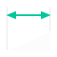 | `dim-linear.svg` | move-horizontal | Linear |
|  | `dim-radius.svg` | radius | Radius |
|  | `dim-style.svg` | ruler | Dimension Style |
|  | `document-tab-close.svg` | x | doc_tabs.rs |
|  | `document-tab-home.svg` | house | doc_tabs.rs |
|  | `document-tab-new.svg` | plus | doc_tabs.rs |
|  | `draw-arc-3p.svg` | rainbow | 3-Point |
|  | `draw-arc-sce.svg` | rainbow | Start, Center, End |
|  | `draw-boundary.svg` | square-dashed | Boundary |
|  | `draw-circle-2p.svg` | circle | 2-Point |
|  | `draw-circle-3p.svg` | circle | 3-Point |
|  | `draw-circle-3t.svg` | circle | Tan, Tan, Tan |
|  | `draw-circle-diameter.svg` | circle | Center, Diameter |
|  | `draw-circle-radius.svg` | circle | Center, Radius, icon_set.rs |
|  | `draw-circle-ttr.svg` | circle | Tan, Tan, Radius |
|  | `draw-divide.svg` | ellipsis | Divide (Lucide's ellipsis: marks along a line.) |
|  | `draw-donut.svg` | donut | Donut (Lucide's donut.) |
|  | `draw-ellipse.svg` | egg | Ellipse (Lucide has no ellipse; its egg is the nearest single oval outline.) |
|  | `draw-gradient.svg` | blend | Gradient |
| 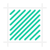 | `draw-hatch.svg` | square-slash | Hatch (A square with a diagonal: the nearest Lucide has to hatching.) |
|  | `draw-line.svg` | minus | Line |
|  | `draw-measure.svg` | between-horizontal-start | Measure (Lucide's marks between two ends.) |
|  | `draw-point.svg` | dot | Multiple Point, Point Style..., Single Point (Lucide's dot.) |
|  | `draw-polygon.svg` | hexagon | Polygon |
|  | `draw-polyline.svg` | spline | Polyline |
|  | `draw-ray.svg` | move-up-right | Ray (Lucide's arrow up and right: a line that leaves a point.) |
|  | `draw-rectangle.svg` | square | Rectangle, icon_set.rs |
|  | `draw-spline.svg` | spline | Spline |
|  | `draw-xline.svg` | slash | Construction Line (Lucide's slash: a line that runs on both ways.) |
|  | `dropdown-arrow.svg` | chevron-down | widgets.rs |
|  | `dynamic-input-locked.svg` | lock | app/dynamic_overlay.rs |
|  | `dynamic-input-options.svg` | chevron-down | app/dynamic_overlay.rs |
|  | `edit-copy-base.svg` | copy-plus | Copy with Base Point |
|  | `edit-copy-clip.svg` | copy | Copy Clip |
|  | `edit-cut.svg` | scissors | Cut |
|  | `edit-paste.svg` | clipboard-paste | Paste |
|  | `edit-paste-block.svg` | box | Paste as Block |
|  | `edit-paste-original.svg` | locate-fixed | Paste to Original Coordinates |
|  | `edit-redo.svg` | redo-2 | app.rs, app/context_menu.rs |
|  | `edit-select-all.svg` | square-dashed-mouse-pointer | Select All |
|  | `edit-undo.svg` | undo-2 | app.rs, app/context_menu.rs |
|  | `file-new.svg` | file | app.rs, app/home_page/start.rs |
|  | `file-open.svg` | folder-open | app.rs, app/home_page/start.rs |
|  | `file-save.svg` | save | app.rs, theme.rs |
|  | `format-linetype.svg` | ellipsis | Linetypes |
|  | `format-units.svg` | ruler | Units |
|  | `gallery-landscape.svg` | rectangle-horizontal | crates/od-ui/examples/gallery.rs |
|  | `gallery-portrait.svg` | rectangle-vertical | crates/od-ui/examples/gallery.rs |
|  | `gallery-preset.svg` | image | crates/od-ui/examples/gallery.rs |
|  | `group-bounding-box.svg` | square-dashed | Group Bounding Box |
|  | `group-edit.svg` | square-pen | Group Edit |
|  | `group-group.svg` | group | Group |
|  | `group-manager.svg` | list | Group Manager |
|  | `group-selection.svg` | square-mouse-pointer | Group Selection On/Off |
|  | `group-ungroup.svg` | ungroup | Ungroup |
|  | `home-more.svg` | ellipsis | app/home_page/controls.rs |
|  | `home-pin.svg` | pin | app/home_page/cards.rs, app/home_page/controls.rs |
|  | `home-template.svg` | layout-template | app/home_page/start.rs |
|  | `home-view-grid.svg` | layout-grid | app/home_page/recent.rs |
|  | `home-view-list.svg` | list | app/home_page/recent.rs |
|  | `inquiry-angle.svg` | triangle-right | Angle |
|  | `inquiry-area.svg` | square | Area |
| 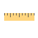 | `inquiry-distance.svg` | ruler | Distance |
|  | `inquiry-id.svg` | locate-fixed | ID Point |
|  | `inquiry-radius.svg` | radius | Radius |
|  | `inquiry-volume.svg` | box | Volume |
|  | `insert-export.svg` | upload | Export File |
|  | `insert-import.svg` | download | Import File |
|  | `layer-freeze.svg` | snowflake | Freeze |
|  | `layer-hide.svg` | lightbulb-off | Off |
|  | `layer-isolate.svg` | focus | Isolate |
|  | `layer-list-frozen.svg` | snowflake | ribbon_slots.rs |
|  | `layer-list-locked.svg` | lock | ribbon_slots.rs |
|  | `layer-list-off.svg` | lightbulb-off | ribbon_slots.rs |
|  | `layer-list-on.svg` | lightbulb | ribbon_slots.rs |
|  | `layer-list-thawed.svg` | sun | ribbon_slots.rs |
|  | `layer-list-unlocked.svg` | lock-open | ribbon_slots.rs |
|  | `layer-lock.svg` | lock | Lock |
|  | `layer-make-current.svg` | layers-2 | Make Current |
|  | `layer-match.svg` | pipette | Match Layer |
|  | `layer-panel-current.svg` | check | layers_ui.rs |
|  | `layer-panel-frozen.svg` | snowflake | freeze |
|  | `layer-panel-locked.svg` | lock | layers_ui.rs |
|  | `layer-panel-off.svg` | eye-off | layers_ui.rs |
|  | `layer-panel-on.svg` | eye | layers_ui.rs |
|  | `layer-panel-unlocked.svg` | lock-open | layers_ui.rs |
|  | `layer-panel-vp-frozen.svg` | snowflake | vp_freeze |
|  | `layer-properties.svg` | layers | Layer Properties |
|  | `layer-show.svg` | lightbulb | Turn All Layers On |
|  | `layer-states.svg` | list | Layer States |
|  | `layer-thaw-all.svg` | sun | Thaw All Layers |
|  | `layer-unisolate.svg` | scan | Unisolate |
|  | `layer-unlock.svg` | lock-open | Unlock |
|  | `manage-settings.svg` | settings | Settings |
|  | `modify-array-path.svg` | waves | Path Array |
|  | `modify-array-polar.svg` | refresh-ccw-dot | Polar Array |
|  | `modify-array-rect.svg` | grid-2x2 | Rectangular Array |
|  | `modify-blend.svg` | spline | Blend Curves |
|  | `modify-break.svg` | scissors-line-dashed | Break |
|  | `modify-chamfer.svg` | triangle-right | Chamfer |
|  | `modify-copy.svg` | copy | Copy, app/context_menu.rs |
|  | `modify-erase.svg` | eraser | Erase |
|  | `modify-explode.svg` | ungroup | Explode |
|  | `modify-extend.svg` | arrow-right-to-line | Extend |
|  | `modify-fillet.svg` | corner-down-right | Fillet |
|  | `modify-hatchedit.svg` | square-slash | Edit Hatch |
|  | `modify-join.svg` | merge | Join |
|  | `modify-lengthen.svg` | move-horizontal | Lengthen |
|  | `modify-matchprop.svg` | paintbrush | Match Properties |
|  | `modify-mirror.svg` | flip-horizontal | Mirror |
|  | `modify-move.svg` | move | Move, app/context_menu.rs |
|  | `modify-offset.svg` | stretch-horizontal | Offset |
|  | `modify-pedit.svg` | waypoints | Edit Polyline |
|  | `modify-rotate.svg` | rotate-cw | Rotate, app/context_menu.rs |
|  | `modify-scale.svg` | maximize | Scale, app/context_menu.rs |
|  | `modify-stretch.svg` | unfold-horizontal | Stretch |
|  | `modify-trim.svg` | scissors | Trim |
|  | `osnap-apparent-intersection.svg` | grid-3x3 | app/status_toggles.rs |
|  | `osnap-centre.svg` | grid-3x3 | app/status_toggles.rs |
|  | `osnap-end.svg` | grid-3x3 | app/status_toggles.rs |
|  | `osnap-extension.svg` | grid-3x3 | app/status_toggles.rs |
|  | `osnap-geo-centre.svg` | grid-3x3 | app/status_toggles.rs |
|  | `osnap-insertion.svg` | grid-3x3 | app/status_toggles.rs |
|  | `osnap-intersection.svg` | grid-3x3 | app/status_toggles.rs |
|  | `osnap-mid.svg` | grid-3x3 | app/status_toggles.rs |
|  | `osnap-nearest.svg` | grid-3x3 | app/status_toggles.rs |
|  | `osnap-node.svg` | grid-3x3 | app/status_toggles.rs |
|  | `osnap-parallel.svg` | grid-3x3 | app/status_toggles.rs |
|  | `osnap-perpendicular.svg` | grid-3x3 | app/status_toggles.rs |
| 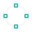 | `osnap-quadrant.svg` | grid-3x3 | app/status_toggles.rs |
|  | `osnap-tangent.svg` | grid-3x3 | app/status_toggles.rs |
|  | `panel-section-closed.svg` | chevron-right | properties_ui.rs |
|  | `panel-section-open.svg` | chevron-down | properties_ui.rs |
|  | `power-select-pick.svg` | mouse-pointer-2 | app/power_select_dialog.rs |
|  | `properties-color.svg` | palette | ribbon_slots.rs |
|  | `properties-linetype.svg` | equal | ribbon_slots.rs |
|  | `properties-lineweight.svg` | align-justify | ribbon_slots.rs |
|  | `ribbon-panel-close.svg` | chevron-up | ribbon.rs |
|  | `ribbon-panel-open.svg` | chevron-down | ribbon.rs |
|  | `ribbon-split-arrow.svg` | chevron-down | app/home_page/start.rs, ribbon/split.rs |
|  | `select-crossing-polygon.svg` | lasso | Crossing Polygon |
|  | `select-fence.svg` | route | Fence |
|  | `select-power.svg` | wand-sparkles | Quick Select, app/context_menu.rs |
|  | `select-window-polygon.svg` | lasso-select | Window Polygon |
|  | `text-align-center.svg` | align-center | mtext_editor/toolbar.rs |
|  | `status-grid-display.svg` | grid-3x3 | app/status_toggles.rs |
|  | `status-grid-snap.svg` | magnet | app/status_toggles.rs |
|  | `status-iso.svg` | grid-3x3 | (not used) |
|  | `status-ortho.svg` | grid-3x3 | app/status_toggles.rs |
|  | `status-osnap.svg` | magnet | app/status_toggles.rs |
|  | `status-otrack.svg` | grid-3x3 | app/status_toggles.rs |
|  | `status-polar.svg` | grid-3x3 | app/status_toggles.rs |
|  | `status-settings.svg` | grid-3x3 | app/status_toggles.rs |
|  | `text-align-justify.svg` | align-justify | mtext_editor/toolbar.rs |
|  | `text-align-left.svg` | align-left | mtext_editor/toolbar.rs |
|  | `text-align-right.svg` | align-right | mtext_editor/toolbar.rs |
|  | `text-list.svg` | list | mtext_editor/toolbar.rs |
|  | `text-redo.svg` | redo-2 | mtext_editor/toolbar.rs |
|  | `text-undo.svg` | undo-2 | mtext_editor/toolbar.rs |
|  | `tools-quickcalc.svg` | calculator | Calculator |
|  | `tool-select.svg` | mouse-pointer-2 | Select |
|  | `view-assistant.svg` | bot | Assistant |
|  | `view-base-inventor.svg` | file | From Inventor |
|  | `view-base-model.svg` | frame | From Model Space |
|  | `view-command-line.svg` | rectangle-horizontal | Command Line |
|  | `view-grid.svg` | grid-3x3 | Grid |
|  | `view-pan.svg` | hand | Pan |
|  | `view-panel-layers.svg` | layers | Layers |
|  | `view-panel-properties.svg` | rectangle-vertical | Properties |
|  | `view-reset-layout.svg` | undo-2 | Reset Layout |
|  | `view-snap.svg` | magnet | Snap |
|  | `view-zoom-extents.svg` | maximize | Zoom Extents |
|  | `view-zoom-in.svg` | zoom-in | Zoom In |
|  | `view-zoom-out.svg` | zoom-out | Zoom Out |
