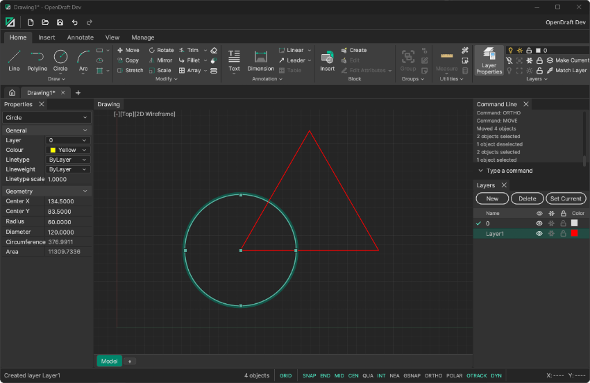

<div align="center">


**A fast, free, open-source 2D CAD application written in Rust.**

[](https://github.com/JamesHodgkins/OpenDraft/actions/workflows/ci.yml)


[](#license)
[](https://github.com/JamesHodgkins/OpenDraft/commits/main)
[](https://github.com/JamesHodgkins/OpenDraft/issues)

<p>
<a href="#-try-it-in-30-seconds">Try it</a> ·
<a href="#-why-opendraft">Why</a> ·
<a href="#-what-it-can-do">Features</a> ·
<a href="#-getting-started">Install</a> ·
<a href="#-roadmap">Roadmap</a> ·
<a href="#-contributing">Contribute</a>
</p>

</div>

<p align="center">
  <b>Built for people who think in command lines.</b><br>
  Type <code>L</code>, press Enter, click two points. A familiar ribbon, a real command line and short aliases, in one small native executable.
</p>

<!-- Add a screenshot or short GIF here, e.g.:
<p align="center"></p>
-->

## ⚡ Try it in 30 seconds

```text
Command: L                              ← Enter, or just press the space bar
Specify first point: 0,0
Specify next point or [Undo]: @100<30   ← typed polar coordinates
Specify next point or [Undo]: <click>   ← or pick with the mouse
Command: O                              ← Offset it
Specify offset distance: 5
Command: TR                             ← Trim, Fillet (F), Chamfer (CHA) ...
```

If that looks familiar, you are home.

## 🎯 Why OpenDraft?

- **Familiar.** A ribbon interface, a command line with the standard drafting command names and short aliases, and step-by-step prompts with options (`Specify first point:`, `[Undo/Close]`). If you have drafted in other CAD packages, your muscle memory carries over.
- **Fast and light.** Written in Rust on [egui](https://github.com/emilk/egui). One native executable, no interpreter, no runtime to install.
- **Opens your drawings.** Reads DXF and DWG (including files saved by AutoCAD 2010 to 2018), writes DXF, and has its own versioned `.odx` format.
- **Robust.** Every change is one undo step, saves are atomic, autosave and crash recovery are built in, and a crash inside a command cannot take down your drawing.
- **Scriptable by AI.** An optional, off-by-default [MCP server](./docs/mcp.md) lets an assistant inspect and draw in your open drawings, with every change undoable.
- **Free for good.** GPL-3.0-or-later, no subscription, no telemetry.

> **Status:** OpenDraft is in early development (0.1). It already covers a large part of everyday 2D drafting, but features, commands and the `.odx` format may still change. See the [roadmap](#roadmap) for what is missing.

## 🧰 What it can do

**✏️ Drawing**
- Line, Circle (centre/radius/diameter, 2P, 3P, TTR, TTT), Arc, Ellipse, Rectangle, Polygon, Polyline (with arc segments), Spline (fit points or control vertices) and Hatch (patterns, solid, boundary detection and Edit Hatch)
- Typed or clicked input for points, distances and angles, with dynamic input and a live preview while you draw

**🔧 Modify**
- Move, Copy, Rotate, Mirror, Scale, Stretch, Trim, Extend, Lengthen, Offset, Fillet, Chamfer, Join, Break, Explode, Erase, rectangular, polar and path Arrays, and Match Properties
- Cut, copy and paste (with base point, as block, to original coordinates), also between drawings
- Window, crossing and fence selection, Power Select (`QSELECT`), grips to stretch, move, rotate, scale, mirror or copy, and a Properties panel for editing entity attributes

**🔤 Annotation**
- Multiline text with an in-place editor and text styles, including the OD Roman stroke font
- Dimensions (linear, aligned, radius, diameter, arc length) with dimension styles, plus Multileaders and Leaders with their styles

**🧱 Blocks and layouts**
- Create and Insert blocks, a Block Editor (`BEDIT`), Purge
- Paper-space layouts with viewports and plotting

**🎯 Canvas and interaction**
- Zoom and pan, grid, ortho and polar tracking, and the full set of object snaps (endpoint, midpoint, centre, intersection, perpendicular, tangent, nearest, parallel, extension and more) with object snap tracking
- Transparent commands: zoom, pan and toggles work while another command is running
- Right-click context menu, undo and redo for every document change, grouped per command

**🖥️ Interface**
- Ribbon interface, quick access toolbar, document tabs and status bar
- Dockable panels (layers, properties, command line) with a saved layout and remembered window state
- Command line with familiar aliases (`L`, `C`, `PL`, `TR`, ...) and system variables via `SETVAR`
- Layers (on/off, freeze, lock, colour, linetype, lineweight) with layer tools such as `LAYFRZ` and `LAYMCUR`, a linetype manager, and current colour, linetype and lineweight
- A Lucide-based icon library exported as SVG, and a dark flat theme

**💾 Files**
- Native `.odx` format (versioned JSON; unknown content is refused rather than silently dropped, loading is size-limited)
- DXF import and export (R12, or R2000 for layouts, ellipses, splines, hatches and text)
- DWG import (AC1024, AC1027, AC1032) through the standalone `od-dwg` reader; there is no DWG export yet
- Atomic saves, background open/save/export with a Cancel button, autosave and crash recovery, and a recent files list

## 🚀 Getting started

Download the latest build from the [Releases page](https://github.com/JamesHodgkins/OpenDraft/releases). A release marked **Pre-release** is a beta.

| System | File |
|---|---|
| Windows 10 or 11 (64-bit) | `OpenDraft-<version>-windows.zip` |
| Linux (64-bit, experimental) | `OpenDraft-<version>-linux.tar.gz` |

Each release also has a `SHA256SUMS` file to check your download against.

### Windows

1. Extract the zip to a folder of your choice. There is nothing to install.
2. Run `opendraft.exe`. The folder also holds `opendraft-mcp.exe` (for [AI assistants](#-ai-assistants-experimental)); keep the two together.
3. **Windows may warn about an unknown publisher.** OpenDraft is not code-signed yet, so SmartScreen can show "Windows protected your PC". If you trust the download (see "Check your download" below), choose **More info**, then **Run anyway**.
4. The 0.1.0-beta.1 build needs the Microsoft [Visual C++ Redistributable](https://aka.ms/vs/17/release/vc_redist.x64.exe), which most machines already have. If Windows says `VCRUNTIME140.dll` is missing, install it.

### Linux (experimental)

```bash
tar -xzf OpenDraft-<version>-linux.tar.gz
cd OpenDraft-<version>-linux
./opendraft
```

It needs the usual desktop libraries (Debian/Ubuntu: `sudo apt-get install -y libxkbcommon0 libwayland-client0 libx11-6 libxcb1 libgl1`). The Linux build is made in CI on Ubuntu 22.04 and has not yet been run on many systems. Reports are welcome.

### Check your download

Compare the file's SHA-256 with the one in `SHA256SUMS`:

```powershell
Get-FileHash .\OpenDraft-<version>-windows.zip -Algorithm SHA256   # Windows
```

```bash
sha256sum -c SHA256SUMS --ignore-missing                          # Linux
```

### First steps

Start a drawing with `L` (Line), `C` (Circle), `REC` (Rectangle) or `PL` (Polyline), then modify it with `M` (Move), `TR` (Trim), `O` (Offset) or `F` (Fillet). Press `F8` for ortho and `F3` for object snaps.

Prefer to build it yourself? See [Build from source](#build-from-source).

## 🤖 AI assistants (experimental)

OpenDraft can let an AI assistant that speaks the [Model Context Protocol](https://modelcontextprotocol.io) read your open drawings, measure them, draw in them and help with files. It is off by default and read-only until you allow more, every change is one Undo step, and files stay inside folders you approve. The download includes the `opendraft-mcp` program next to `opendraft` (or [build it from source](#build-from-source)); turn it on in Settings > Automation and see [docs/mcp.md](./docs/mcp.md) for setup, what it can do and troubleshooting.

## 🔒 Privacy

OpenDraft makes no network requests unless you allow it. The one thing it can do is check for new versions: on the Home page, or in Settings > Updates, you choose whether it may ask GitHub once a day which versions have been released. The request carries OpenDraft's version number and, as any web request does, your internet address; no drawings or personal details are sent. Nothing is downloaded or installed: a newer version is announced and its release page opens only when you click. Choose "Don't check" (or untick the setting) and it never contacts GitHub on its own. The AI assistant feature (above) is local and separate.

## 🛠️ Development

### Build from source

You need a recent stable [Rust toolchain](https://rustup.rs/).

```bash
git clone https://github.com/JamesHodgkins/OpenDraft.git
cd OpenDraft
cargo run --release -p od-app
```

The binary is called `opendraft`. To build the AI assistant program too: `cargo build --release -p od-app -p od-mcp` (both end up in `target/release`).

On Linux you also need the windowing development libraries first (Debian/Ubuntu):

```bash
sudo apt-get install -y libxkbcommon-dev libwayland-dev libx11-dev libxcb1-dev libgl1-mesa-dev
```

A debug build keeps its settings apart from an installed release (see [CONTRIBUTING.md](./CONTRIBUTING.md)).

### Checks

CI runs formatting, clippy and the tests on Windows and Linux. To run the same checks locally:

```bash
cargo fmt --all --check
cargo clippy --workspace --all-targets -- -D warnings
cargo test --workspace
```

Warnings are errors in CI (`RUSTFLAGS=-D warnings`). `unsafe` is forbidden, and `unwrap`, `todo!`, `dbg!` and prints are linted in production code.

### Project layout

| Crate | Purpose |
|---|---|
| `od-core` | Document, entities and geometry |
| `od-commands` | Command registry, undo history, sessions and the `Editor` used by commands |
| `od-files` | File formats: native `.odx`, DXF, DWG import, atomic save |
| `od-dwg` | A standalone DWG reader (no dependencies on the rest of the workspace) |
| `od-canvas` | Camera, drawing view, hit-testing, snapping, selection |
| `od-ui` | Theme, widgets, ribbon, icons, shortcuts |
| `od-api` | The wire contract for AI assistants and other outside callers (ids, messages, limits, the file-path gate) |
| `od-mcp` | `opendraft-mcp`, the MCP server program that talks to the running app |
| `od-app` | The application: state, command table, panels, dock, the automation host |

Dependencies point downward: the document knows nothing about the UI. Read [ARCHITECTURE.md](./ARCHITECTURE.md) for the rules new code follows, and [ui_plan.md](./ui_plan.md) for the interface plan and what is done.

## 📍 Roadmap

Work follows the standard 2D drafting command set; `ui_plan.md` has the detailed to-do list.

- Next: the remaining draw commands (Point, Donut, Boundary, Construction line, Ray), Distance and Area, Overkill and associative arrays
- Spline editing (trim, extend, break, join, offset)
- The rest of dimensions (associativity, a styles table, real DXF dimensions), block attributes, ByBlock and dynamic blocks
- Linetypes from `.lin` files, hatch gap tolerance and gradients
- DWG export, PDF and SVG export
- A first proper run on Linux
- Plugin system for third-party commands

## 🤝 Contributing

Contributions are welcome, from bug reports to whole commands. Every command is a small function that asks for input and records one undo step, so adding one is a good first project: [ARCHITECTURE.md](./ARCHITECTURE.md) walks through it, and `ui_plan.md` lists what is next. Please read the [contribution guidelines](./CONTRIBUTING.md) and our [Code of Conduct](./CODE_OF_CONDUCT.md), and open an issue to discuss larger changes first. Changes must pass `cargo fmt`, `cargo clippy` and `cargo test`.

## 💬 Feedback and support

Use the [issue tracker](https://github.com/JamesHodgkins/OpenDraft/issues) for bug reports and feature requests.

Email: jhodgkins@proton.me

## 📜 License

OpenDraft is licensed under the GNU General Public License v3.0 (GPL-3.0). The full text is in the [LICENSE](./LICENSE) file.

## 🙏 Acknowledgments

⭐ If OpenDraft is useful or interesting to you, a star on GitHub helps others find it.

AutoCAD, DWG and DXF are trademarks or registered trademarks of Autodesk, Inc. OpenDraft is an independent project and is not affiliated with, endorsed by or sponsored by Autodesk. Names are used only to describe file and command compatibility.

Thanks to the creators and contributors of the open-source CAD projects that inspired this one, and to the [egui](https://github.com/emilk/egui) community.
